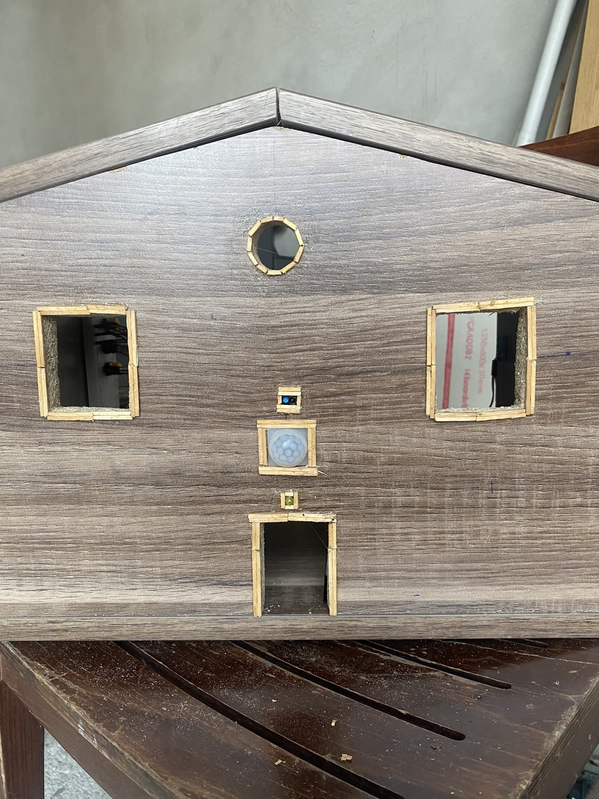
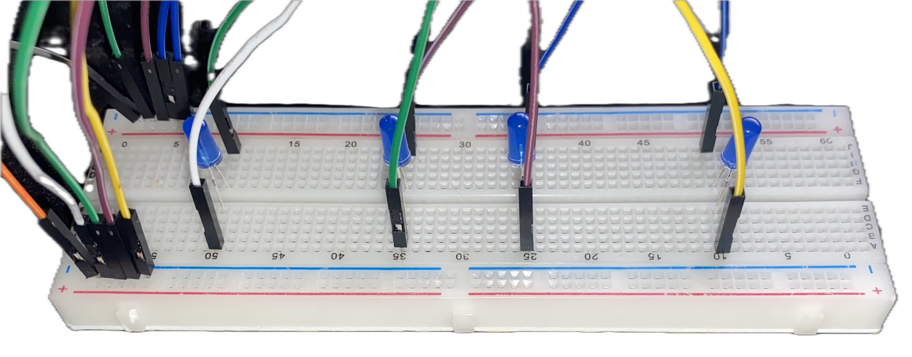
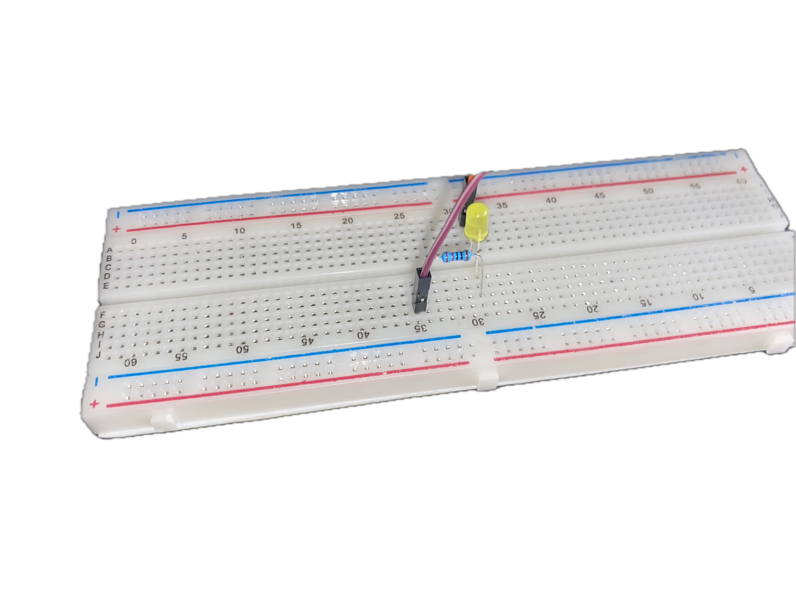
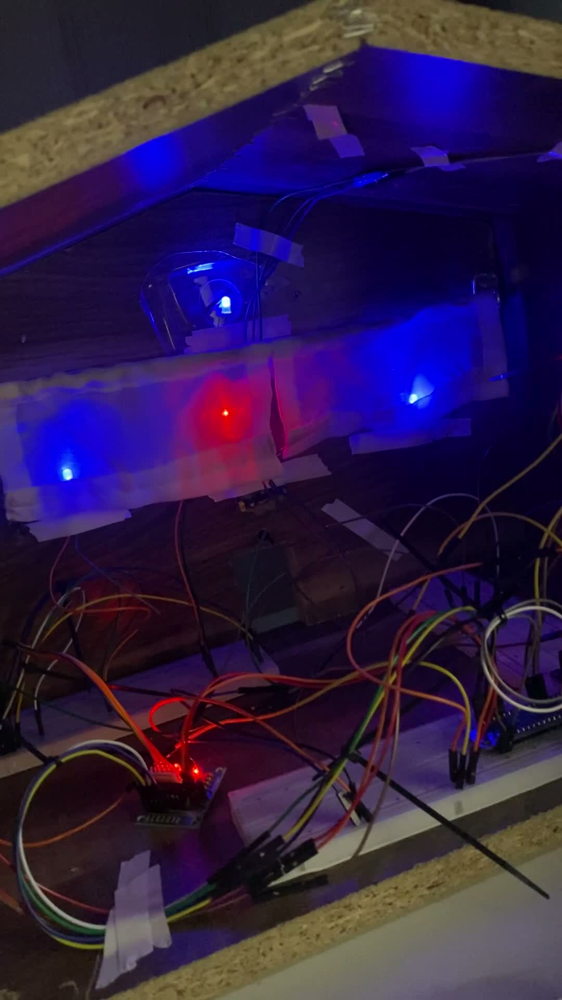

# Hausautomatisierung mit Raspberry Pi

**Beleuchtung und Jalousien in einem Holzmodell – programmiert mit Python.**

Für dieses Projekt habe ich ein Modellhaus aus Holz aufgebaut und mit Sensoren, LEDs und einer motorisierten Jalousie ausgestattet. Ein Raspberry Pi verarbeitet die Eingangssignale und steuert die angeschlossenen Komponenten. Das Projekt verbindet Programmierung, Elektronik und den praktischen Aufbau eines kleinen Automatisierungssystems.



*Das Holzhaus von außen: Eine gelbe LED stellt die Außenleuchte dar. Der Bewegungssensor an der Fassade erkennt Bewegung und löst das Einschalten des Lichts aus.*

## Funktionen

| Funktion | Umsetzung |
| --- | --- |
| Außenbeleuchtung | Ein PIR-Bewegungssensor erkennt Bewegung und schaltet eine LED als Außenlicht ein. |
| Innenbeleuchtung | Ein Touchsensor dient als Lichtschalter für die LEDs im Haus. |
| Automatische Jalousie | Ein Lichtsensor löst die Bewegung eines Schrittmotors aus. Bei Lichteinfall fährt die Jalousie herunter. |
| Manuelle Jalousie | Ein Taster wechselt zwischen Automatik und manueller Bedienung. Zwei weitere Taster steuern die beiden Fahrtrichtungen. |

## Vom Testaufbau zum Holzhaus

Vor dem Einbau ins Haus habe ich die Beleuchtung auf Steckbrettern aufgebaut und getestet. Die folgenden Fotos zeigen diese Zwischenschritte und die elektrische Umsetzung außerhalb des Modells.

### Innenbeleuchtung – Testaufbau



*Vier blaue LEDs mit Anschlussleitungen auf dem Steckbrett. An diesem Aufbau habe ich die spätere Innenbeleuchtung vor dem Einbau getestet; im Projekt schaltet ein Touchsensor das Licht.*

### Außenbeleuchtung – Testaufbau



*Gelbe LED mit Widerstand und Anschlussleitungen als Testaufbau der Außenleuchte. Die Schaltung wurde zunächst außerhalb des Hauses erprobt und anschließend in das Modell eingebaut. Der Bewegungssensor ist auf der Außenansicht oben zu sehen.*

## Das Projekt in Aktion

### Vorführung des Prototyps

Sensoren, Beleuchtung, Motor und Bedienelemente am Versuchsaufbau.

https://github.com/user-attachments/assets/734a682b-2565-4be7-85cc-240b7da59799

### Jalousie im Holzhaus

Die eingebaute Mechanik im Modell.

https://github.com/user-attachments/assets/7c540e90-aecc-45b6-93da-39b275ee1e70

**Downloads:** [Vorführung des Prototyps](assets/videos/prototyp-vorfuehrung.mp4) · [Jalousie im Holzhaus](assets/videos/jalousie-im-holzhaus.mp4)



## Technik

**Python · Raspberry Pi · RPi.GPIO · GPIO-Ein- und Ausgänge · Sensorik · Schrittmotor · Threading**

Für den Aufbau habe ich Breadboards, Jumperkabel, LEDs, einen Bewegungs- und einen Lichtsensor, einen Touchsensor sowie einen Schrittmotor mit Treiberplatine verwendet. Die Software verarbeitet die Touch-Eingabe und die Jalousieautomatik in getrennten Threads. Tastereingaben werden über GPIO-Callbacks verarbeitet.

Die [technischen Erläuterungen](docs/technik.md) beschreiben die Pinbelegung, die Programmlogik und die Grenzen des vorhandenen Codes. Eine [Projektbeschreibung](docs/projektbeschreibung.md) fasst Aufbau und Umsetzung zusammen.

## Code und Projektstand

Die Datei [motor_und_touchpad.py](src/motor_und_touchpad.py) enthält meinen erhaltenen Originalcode für **Innenbeleuchtung und Jalousie**. Sie wurde für dieses Repository nur umbenannt; ihr Inhalt ist unverändert.

Die Außenbeleuchtung gehört zum gebauten Projekt und ist in der ursprünglichen Projektarbeit beschrieben. Ihre separate Python-Datei liegt hier noch nicht vor. Der vorhandene Code ist ein damaliger Hardwareprototyp; mögliche Verbesserungen sind in den technischen Erläuterungen festgehalten.

### Ausführung

Benötigt werden Python 3, `RPi.GPIO` und ein dazu passender Raspberry Pi mit der angeschlossenen Hardware. Die verwendeten BCM-Pins stehen in der [Pinbelegung](docs/technik.md#pinbelegung).

```bash
python3 src/motor_und_touchpad.py
```

Das Programm greift direkt auf GPIO-Pins zu. Es ist keine Simulation für einen gewöhnlichen PC. Eine erneute Funktionsprüfung am ursprünglichen Aufbau steht noch aus; die Python-Syntax wurde beim Aufbereiten des Repositorys geprüft.

## Dateien

```text
.
├── README.md
├── requirements.txt
├── src/
│   └── motor_und_touchpad.py
├── docs/
│   ├── projektbeschreibung.md
│   └── technik.md
└── assets/
    ├── images/
    └── videos/
```

## Autor

**Enes Türksever** · [GitHub](https://github.com/trksEnes) · [Portfolio](https://enes-tuerksever.de)
