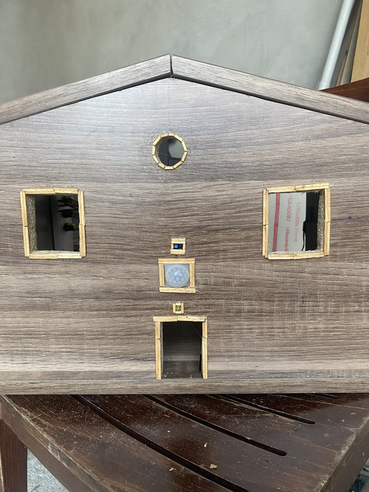
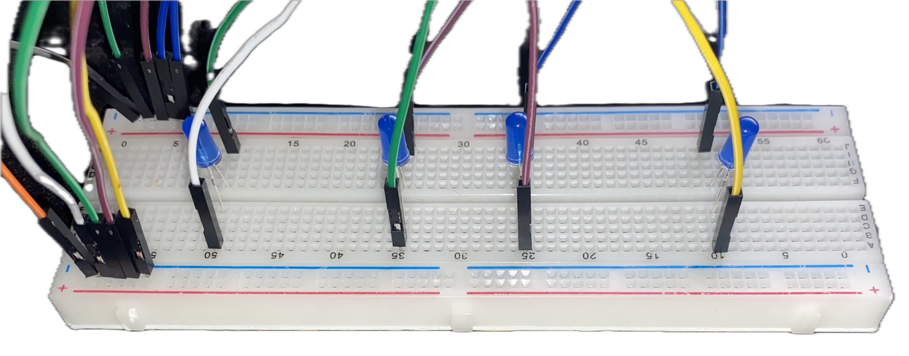
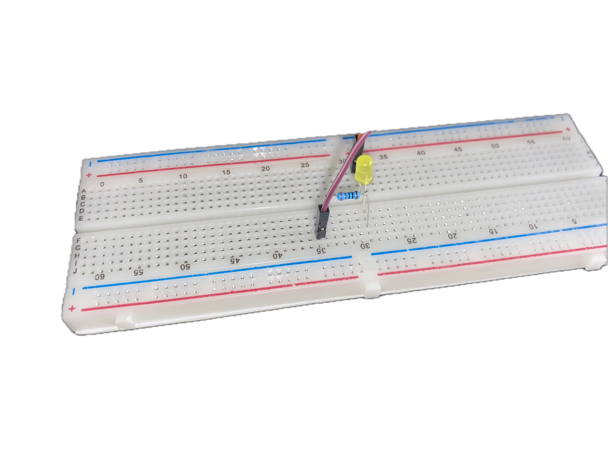

# Projektbeschreibung

## Ziel

An einem Modellhaus aus Holz habe ich drei typische Funktionen einer Hausautomatisierung umgesetzt: eine bewegungsabhängige Außenbeleuchtung, eine per Touchsensor schaltbare Innenbeleuchtung und eine lichtabhängige Jalousie mit manueller Bedienung.

## Aufbau

Der Raspberry Pi verbindet die Software mit den Sensoren und Aktoren. Die Komponenten wurden über Breadboards und Jumperkabel angeschlossen. LEDs stellen die Innen- und Außenbeleuchtung dar. Ein Schrittmotor bewegt die Jalousie im Holzmodell.

Die ursprüngliche Projektarbeit nennt folgende Komponenten:

| Bauteil | Aufgabe |
| --- | --- |
| Raspberry Pi | Auswertung der Eingänge und Ansteuerung der Ausgänge |
| GPIO-Erweiterungsboard und Breadboards | Anschluss und Aufbau der Schaltungen |
| PIR-Bewegungssensor HC-SR501 | Bewegungserkennung für das Außenlicht |
| Touchsensor TTP223B | Bedienung der Innenbeleuchtung |
| Lichtschaltmodul mit LM393 | Digitales Signal zur Helligkeitserkennung |
| Schrittmotor 28BYJ-48 mit Treiberplatine | Bewegung der Jalousie |
| Drei Taster | Betriebsartwechsel und manuelle Fahrtrichtungen |
| LEDs, Widerstände und Jumperkabel | Beleuchtung und elektrische Verbindungen |

Die Modellbezeichnungen stammen aus der damaligen Dokumentation. Die genaue Ausführung und Verdrahtung der verwendeten Module müssen vor einem Nachbau am realen Aufbau überprüft werden.

## Fotos aus der Umsetzung

### Außenansicht des Holzhauses

Die gelbe LED stellt die Außenleuchte dar. Der an der Fassade eingebaute PIR-Bewegungssensor erfasst Bewegung und löst das Einschalten der Beleuchtung aus.

### Testaufbau der Innenbeleuchtung

Die LEDs und ihre Anschlüsse wurden zunächst außerhalb des Hauses auf einem Steckbrett aufgebaut und getestet. Das Foto zeigt diesen Zwischenschritt vor dem Einbau. Im Gesamtprojekt wird die Innenbeleuchtung über den Touchsensor geschaltet.

### Testaufbau der Außenbeleuchtung

Auch die Außenleuchte wurde vor dem Einbau separat erprobt. Zu sehen sind die gelbe LED, ein Widerstand und die Anschlussleitungen. Der Bewegungssensor ist auf diesem Foto nicht abgebildet; seine Montage zeigt die Außenansicht des Holzhauses.

## Umsetzung

### Außenbeleuchtung

Ein Bewegungssensor meldet erkannte Bewegung an den Raspberry Pi. Dieser schaltet die LED für den Außenbereich ein. Die ursprüngliche Dokumentation enthält hierzu einen Codeausschnitt; eine eigenständige Quelldatei ist im erhaltenen Material nicht enthalten. Deshalb wird hier keine vollständige Software für diese Funktion ergänzt oder als Originalcode ausgegeben.

### Innenbeleuchtung

Der Touchsensor dient als Lichtschalter. Im erhaltenen Python-Programm liest ein eigener Thread den Sensor aus und schaltet den LED-Ausgang abhängig vom gespeicherten Lichtzustand um.

### Jalousie

Im Automatikbetrieb wertet die Software das digitale Signal des Lichtsensors aus. Bei einem geänderten Sensorzustand wird eine der beiden Drehrichtungen gewählt. Der Motor wird über eine achtteilige Schrittfolge angesteuert; die automatische Bewegung läuft zeitgesteuert.

Ein mittlerer Taster dient zum Unterbrechen beziehungsweise Fortsetzen der Automatik. Im manuellen Betrieb bewegen zwei weitere Taster den Motor in die jeweilige Richtung, solange der entsprechende Taster gehalten wird. Die Zuordnung zu „hoch“ und „runter“ hängt von der mechanischen Montage ab.

## Praktische Erfahrungen

Die Verbindung von Sensoren, Software und Mechanik war ein zentraler Teil des Projekts. Besonders die Abstimmung der automatischen Jalousiebewegung mit den manuellen Eingaben erforderte Aufmerksamkeit. Die Dokumentation beschreibt außerdem die Empfindlichkeit und Platzierung des Bewegungssensors sowie die Erkennung von Zustandswechseln am Lichtsensor als Themen während der Umsetzung.

## Erhaltener Stand

Das Repository enthält den unveränderten Python-Code für Touch-Beleuchtung und Jalousie, zwei aufbereitete Demonstrationsvideos, daraus entnommene Standbilder sowie Fotos der Außenansicht und der Testaufbauten für die Beleuchtung. Die Erläuterungen wurden anhand des Codes, der ursprünglichen Word-Dokumentation, der Fotos und der bereitgestellten Projektangaben erstellt. Die ursprünglichen Dateien bleiben außerhalb dieses Repositorys erhalten.

Die [technischen Erläuterungen](technik.md) unterscheiden das beabsichtigte Verhalten des Modells vom tatsächlich erhaltenen Softwarestand. Eine ergänzende Präsentation kann später hinzugefügt werden.
